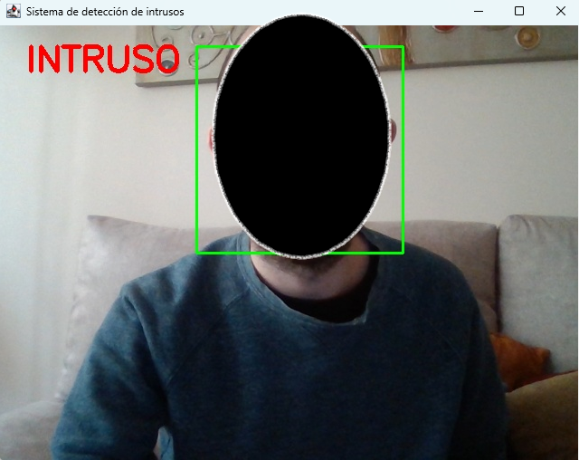
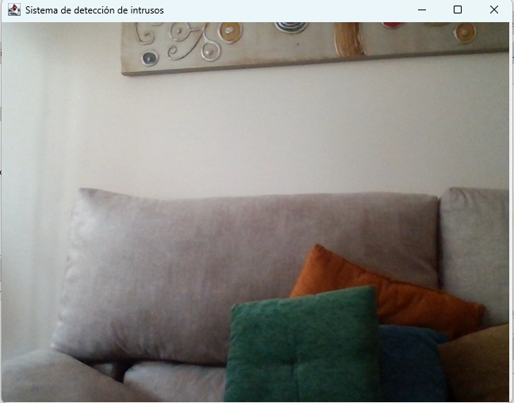

# Intrusion Detection System — Java & OpenCV

A Java desktop application that uses computer vision to detect human faces in real time through a webcam and display an intrusion alert.

The project was developed as part of the **Higher Technician Diploma in Multiplatform Application Development (DAM)**. It demonstrates the integration of webcam input, image processing, face detection, and graphical user interfaces in Java.

## Features

- Real-time video capture using a webcam.
- Face detection using OpenCV and a pretrained Haar Cascade classifier.
- Green bounding boxes around detected faces.
- Visual **"INTRUSO"** alert whenever a face is detected.
- Console alerts when a face first enters the camera's field of view.
- Automatic release of camera resources when the application closes.

## Technologies

| Technology | Purpose |
|---|---|
| Java 21 | Application development |
| OpenCV 4.9.0 | Computer vision and face detection |
| Java Swing | Graphical user interface |
| Apache Maven | Dependency management |
| Haar Cascades | Pretrained face detection classifier |
| Apache NetBeans 31 | Development environment |

## How It Works

1. The application accesses the default webcam using OpenCV's `VideoCapture` class.
2. Each captured frame is converted to grayscale and processed to improve contrast.
3. A pretrained Haar Cascade classifier analyzes the image to locate faces.
4. When a face is detected, the application draws a green bounding box and displays **"INTRUSO"** in red.
5. A message is also printed to the console when face detection begins.
6. The application continues monitoring until the window is closed.

## Requirements

- Java Development Kit (JDK) 21
- Apache Maven
- A working webcam
- A compatible desktop operating system

## Installation and Execution

1. Clone or download this repository.
2. Open the project in Apache NetBeans or another Maven-compatible Java IDE.
3. Allow Maven to download the required dependencies.
4. Verify that `haarcascade_frontalface_default.xml` is available in `src/main/resources`.
5. Run the `com.cesur.detectorintrusos.DetectorIntrusos` class.
6. Position a face in front of the webcam to activate the alert.

## Screenshots

### Face Detection

The application identifies faces in real time, draws a green bounding box around each detected face, and displays a red "INTRUSO" alert.

### No Face Detected

When no faces are detected, the application continues monitoring the webcam feed without displaying an intrusion alert.

## Limitations

This is an educational computer vision prototype, not a production-ready security system.

The application detects the presence of human faces but does not identify individuals or determine whether they are authorized to enter a location.

Detection accuracy may vary depending on lighting conditions, camera quality, face orientation, and distance from the webcam.

## Possible Future Improvements

- Event logging with timestamps.
- Automatic image capture when a face is detected.
- Email or desktop notifications.
- Improved detection using modern deep learning models.
- A more advanced graphical interface.

## Acknowledgments

Face detection is implemented using OpenCV and its pretrained Haar Cascade classifier.

The project was developed for educational purposes as part of the Multiplatform Application Development curriculum.